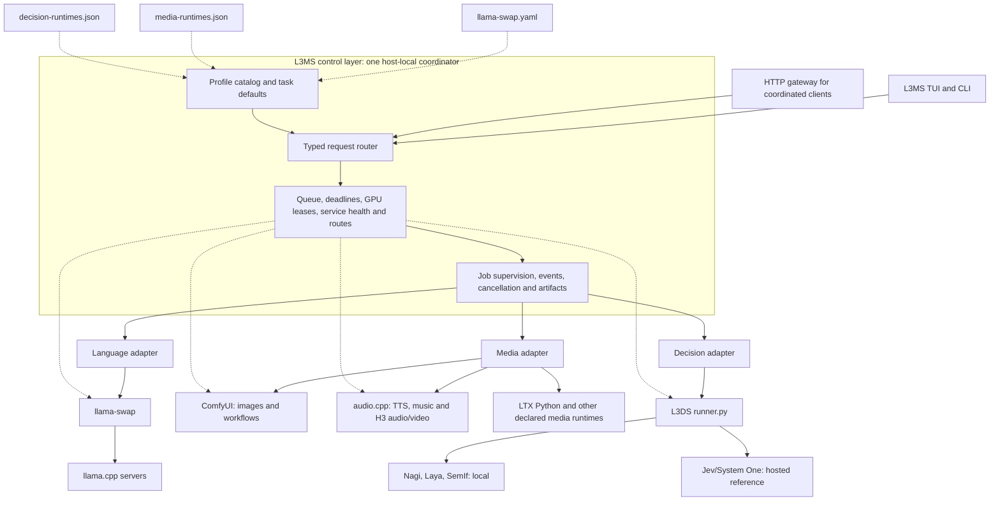

# Monorepo consolidation plan

Status: phased implementation proposal; no implementation phase is complete. Keep the L3MS name and use **Local 3-Mode Model Stack** as its
expanded form: language, media, and decisions are the three inference modes.
The existing `l3ms` GitHub slug, checkout, executable, environment variables,
and deployed paths remain the compatibility baseline.

```text
L3MS
|
+- L  Local
+- 3  Three model lanes
|     +- Language                 (current L3MS)
|     +- Latent media             (L2M2)
|     `- Low-latency decisions    (L3DS)
+- M  Models
`- S  Stack
```

## Goal

Bring L2M2 (media models) and L3DS (decision models) into the L3MS Git repository
without interrupting current language-model serving, media generation, or decision
experiments. First establish a safe folder structure and preserve each toolkit's
behavior. Then deliver one operator workbench with shared UI, configuration,
job supervision, and runtime routing over three independently usable toolkits.

The folder-migration milestone is complete when one Git repository contains all
three source trees, the existing commands still work, ignored runtime state and model weights remain
available, CI verifies each toolkit, and the deployed services have passed their
own smoke checks. Repository consolidation alone does not imply a unified model
interface or a new serving daemon. The unified-product milestone additionally
requires the shared control, coordinated inference, workbench, and public-site
gates in Phases 4–9. Phase 10 retires the old launch paths after acceptance.

## Initial layout: folder structure first

```text
~/repos/l3ms/                  # Existing Git repository and deployed path
├── Cargo.toml                 # Existing L3MS package, unchanged initially
├── Cargo.lock                 # Existing L3MS lockfile, unchanged initially
├── src/                       # Existing L3MS Rust workbench
├── llama-swap.yaml             # Existing router configuration and paths
├── bench-models/              # Existing language-model experiments
├── model_downloader/          # Existing L3MS downloader and config
├── maintenance/               # Existing L3MS operations and service files
├── docs/                      # Existing dashboard and documentation
└── toolkits/
    ├── l2m2/                  # Entire media source tree, own Cargo.toml
    │   ├── media-runtimes.json
    │   ├── media-models/
    │   ├── model_downloader/  # Keep the compatibility copy for phase 1
    │   ├── maintenance/
    │   ├── docs/
    │   └── workflows/
    └── l3ds/                  # Entire decision source tree, own Cargo.toml
        ├── decision-runtimes.json
        ├── decision-models/
        ├── maintenance/
        └── suites/
```

`toolkits/` is intentional: both children include Python, scripts, manifests,
documentation, and runtime setup, so they are more than Rust crates. Keep the
names `l2m2` and `l3ds` for their binaries and folders. Preserve each child's
`.gitignore`, license, README, and `AGENTS.md` inside its folder. Do not add a
root Cargo workspace in the folder-migration change. Building from each child
directory then continues to use its own lockfile and `target/` layout.

Do not relocate L3MS's root files in this migration. The systemd unit uses
`%h/repos/l3ms` as its working directory and `L3MS_ROOT`; `llama-swap.yaml`
uses that root for vendor binaries and the chat template. Other scripts and
homelab documentation also refer to the path. Keeping it stable removes a
large, unrelated source of breakage.

## Compatibility contract

| Surface | Compatibility requirement |
| --- | --- |
| L3MS checkout and executable | Keep `~/repos/l3ms`, `l3ms`, `L3MS_ROOT`, `~/.l3ms`, `llama-swap.yaml`, and existing CLI flags. |
| L3MS service | Keep the current `llama-swap.service`, host-specific port, API key handling, model paths, and router behavior. |
| L2M2 | Keep `l2m2`, `--root`, profile IDs, `media-runtimes.json`, script argv behavior, and supported `L3MS_*` variables. |
| L3DS | Keep `l3ds`, `--root`, profile IDs, `decision-runtimes.json`, and the `system_one(state, questions)` behavior. |
| Local state | Keep weights, outputs, venvs, vendor builds, `.toolkit` snapshots, and model caches out of Git. Inventory and migrate what a new runtime path actually needs. |
| URLs | Keep the existing dashboard domain and live inference endpoints. Apply the agreed name expansion in the documentation pass; keep the repository slug. |

Existing sibling checkouts at `~/repos/l2m2` and `~/repos/l3ds` remain intact
through validation and serve as immediate fallbacks. A source move must not
silently switch a running service or delete its runtime state.

## Target architecture — Shared control, independent toolkits

Target module placement after the import (incremental, not a bulk source move):

```text
src/
  main.rs, lib.rs           # application composition and module exports
  app.rs, cli.rs           # entry points; delegate to UI and operational modules
  ui/                      # shared shell, navigation, jobs/logs/settings views
  control/
    catalog.rs             # namespaced profile discovery and readiness
    config.rs              # shared config resolution and validated edits
    runtime.rs             # lifecycle, resource ownership, route resolution
    inference.rs           # request dispatch, activation, queueing, cancellation
    jobs.rs                # shared supervision and persistent job records
  lanes/
    language.rs            # language adapter and language-specific UI logic
    media.rs               # L2M2 adapter and media-specific UI logic
    decisions.rs           # L3DS adapter and decision-specific UI logic
toolkits/l2m2/             # media inference, scripts, manifests, standalone CLI
toolkits/l3ds/             # decision inference, suites, manifests, standalone CLI
llama-swap.yaml            # authoritative language config; deployed path preserved
bench-models/              # language scripts; deployed paths preserved
```

These are ownership seams. Move existing settings, jobs, and supervision code
behind them incrementally; do not create a second implementation next to the
existing one. The shared UI owns navigation and common views. Each lane owns
its task-specific inputs, validation, presentation, and native runtime adapter.
The composition root wires them together. Shared control modules do not import
UI or lane implementations; adapters satisfy their interfaces. Toolkits never
import each other's internals or share a Python environment by default.

The catalog interface is `list` and `inspect`, returning source and readiness.
Runtime control exposes `status`, `activate`, `deactivate`, and `resolve_route`.
Inference dispatch owns `submit`, request status/events, and `cancel`; submission
may activate or switch engines under the configured policy.
Distinguish profiles from runtimes: many language profiles share one llama-swap
runtime. A resolved route describes a native chat/media endpoint or a local
runner, with authentication references, rather than one generic inference
request. Hosted decision endpoints require no local GPU lease.

The existing job supervisor is the shared seam for process lifecycle. When
standalone CLIs need shared Rust implementation, extract the operational modules
into a small `crates/stack-control` library usable by all entry points. That is
also the trigger for the conditional workspace change described below. Workspace
adoption need not wait for the public site. Avoid speculative crates for every folder or a catch-all `common`.

### Planned engine map



Solid arrows are inference/job dispatch; dotted arrows are configuration reads
or lifecycle checks. The coordinator contains the routing decision and resource
policy, not the model kernels. It reads the three native manifests, resolves a
task/profile to a runtime, and gives the selected adapter a native request.
The scheduler holds a GPU lease for the full active stream or job, then can
release or switch engines for queued work. An idle but loaded model still owns
its resident GPU allocation; job completion alone never proves VRAM is free.
CPU and hosted decision requests
do not need that GPU lease. The gateway is an ingress to the same coordinator
for clients that need automatic switching; existing direct backend endpoints
remain available and bypass coordinated scheduling.

### Request-driven inference routing and engine swapping

Automatic engine selection on inference calls is a target behavior. A caller
submits a typed request with a task and optional namespaced profile. The router
resolves the explicit profile or configured task default, checks capability and
readiness, acquires the required resources, activates the correct engine, and
dispatches the request through its native adapter. Keep llama-swap responsible
for switching language models; the stack router coordinates between llama-swap
and other inference engines. It must not separately supervise llama-swap's model
children.

Example on the single-GPU host:

```text
chat request     -> language adapter -> llama-swap -> language model
image request    -> queue until active GPU work drains
                 -> stop competing language runtime and verify VRAM release
                 -> activate ComfyUI -> execute workflow -> return artifact
next chat request -> drain media work -> release ComfyUI's GPU allocation
                  -> activate llama-swap -> dispatch chat
```

Use the least disruptive verified adapter action that releases the required
resources: a native unload operation where supported, otherwise stopping the
owned process/service. Verify release before activating the next engine. CPU
and hosted requests can proceed concurrently when they do not require the same
resources. Audio/TTS jobs and local decisions participate in the same scheduling
rules as language and image generation.

- **Routing policy:** explicit profile first, then configured task default. Missing
  dependencies or weights produce an actionable error; do not auto-download or
  silently substitute a hosted provider. Preserve native request/response types:
  chat streams, media jobs/artifacts, and typed decisions.
- **Active work:** default to draining accepted work before switching. Hold the
  lease through streaming completion or actual media/decision job completion,
  not merely until submission returns. Never kill active inference to satisfy a
  new request unless an explicit preemption policy permits it.
- **Queueing:** use bounded queues and deadlines covering queue wait, cold start,
  and execution. Start with FIFO for conflicting resource requests to avoid
  starvation; any later engine batching must preserve bounded waiting. Cancelled
  queued requests must not activate an engine. Define idle TTL/minimum residency
  policy without allowing it to override request deadlines.
- **Failures:** serialize transitions, reconcile actual process state, and release
  resources after verified cleanup. Attempt restoration after a failed switch;
  report both the request error and any recovery failure. Do not blindly retry
  submitted media jobs or partially emitted chat streams. Propagate request IDs
  and retain backend job IDs so uncertain completion can be reconciled. Persist
  accepted jobs before dispatch. On coordinator restart, reconcile backend jobs,
  processes, and resource ownership before accepting new conflicting work; mark
  uncertain outcomes explicitly and never automatically replay them.
- **Return policy:** default to keeping the last engine warm until idle expiry or
  a conflicting request. Optionally restore a configured preferred serving mode
  after a job; make that host policy explicit to avoid unnecessary swapping.

All inference entry points that promise automatic swapping must enter this
scheduler, including the shared UI and supported CLI launchers. Existing direct
backend endpoints remain compatible but bypass scheduling; detect their active
work where possible and refuse an unsafe transition when it cannot be drained
reliably. Checking that the backend is idle once is insufficient: a direct request
could arrive while it is being stopped. Before releasing an engine, use an
adapter-supported admission barrier and drain acknowledgement. If a backend
cannot prevent new direct work, require exclusive coordinated ingress for that
runtime or refuse the automatic switch. Record the selected mode per host before
Phase 6 goes live. Document which endpoint provides coordinated inference.

Start with the in-process dispatch interface for a single caller and cross-process
resource locks for exclusion. For coordinated scheduling across independent CLI
processes or HTTP clients, use a single host-local coordinator owning the queue
and leases; locks alone cannot provide global FIFO or track all in-flight work.
CLI/UI callers submit through local IPC; HTTP ingress uses a gateway adapter to
the same coordinator. Phase 6 delivers coordinated local clients; Phase 7 adds
HTTP ingress with native protocol adapters, authentication, streaming/cancellation,
and durable media job tracking. Keep existing public URLs unchanged until an explicit endpoint cutover.
Read-only catalog, status, and route discovery never cause an engine swap.

| Responsibility | Owner and source of truth | What L3MS shares |
| --- | --- | --- |
| Language profiles and serving | Root `llama-swap.yaml`; llama-swap owns live model state and chat/embedding routes. | Catalog display, health, load/unload controls, telemetry, jobs. |
| Media profiles and generation | `toolkits/l2m2/media-runtimes.json`, scripts, ComfyUI workflows, and audio.cpp. | Catalog display, task-aware launch forms, supervised jobs, output/artifact links, runtime status. |
| Decision profiles and evaluation | `toolkits/l3ds/decision-runtimes.json`, Python runner, and suites. | Catalog display, bounded decision runs, latency/option-flip results, jobs. |
| Operator preferences | Existing non-secret L3MS settings store, extended only for cross-toolkit defaults and endpoint locations. | One settings view and consistent validation; secrets stay in environment or existing service configuration. |
| Resource and route state | Actual systemd services, runtime health endpoints, GPU telemetry, and host route configuration. | Read-only status first; manual and request-driven switching through the same coordinator later. |

## Delivery sequence and evidence

| Phase | Deliverable | Depends on |
| --- | --- | --- |
| 0 | Protected baseline, source snapshots, runtime inventory | None |
| 1 | Source histories imported into isolated folders | 0 |
| 2 | Independent builds, path compatibility, CI | 1 |
| 3 | Verified runtime cutover with working rollback | 2 |
| 4 | Shared catalog, config resolution, job contracts | 3 |
| 5 | Runtime adapters and safe manual engine transitions | 4 |
| 6 | One coordinator and request-driven swapping for local clients | 5 |
| 7 | HTTP ingress to the same scheduler | 6 |
| 8 | Unified workbench, media/TTS and decision flows | 6; HTTP views depend on 7 |
| 9 | Public site with separate evidence for each lane | 4 to develop; 8 to release |
| 10 | Acceptance record and retirement of old launch paths | 7, 8, 9 |

Phases are delivery gates, not single commits. Use small reviewable changes within
each phase and record the exact revision, verification commands/results, runtime
host, and rollback point before advancing. Mark unavailable live checks pending;
do not count mocks or skipped checks as live acceptance. Keep sanitized evidence
under `docs/migration/`; keep secrets and machine backups outside Git. Track
committed implementation tasks in the authoritative L3MS Linear project.

Read-only UI work may begin after Phase 4; inference actions ship after Phase 6.
The workspace change is conditional and can accompany shared-code extraction;
it is not a late phase blocking earlier integration. Each user-visible delivery
updates the applicable changelog and operator instructions.

## Phase 0 — Record and protect the baseline

**Depends on:** None.

1. Record the three current commit IDs, branch names, status output, remotes,
   and live service configuration. Re-record status at execution time; earlier
   counts are not migration inputs. L2M2's untracked directories include
   workflows, prompts, runtime locks, and `models/`; classify their contents
   before deciding what is source, experimental evidence, or local data.
2. Make recoverable Git bundles or equivalent backups of all three histories.
   Capture intended tracked and untracked source work in isolated migration
   snapshots. Do not use a broad `git add .`, `git stash -u`, or a recursive
   copy of the working trees: the repositories contain ignored vendor clones,
   builds, virtual environments, and potentially large local assets.
3. Record a file inventory for ignored state that must survive deployment:
   L3MS `vendor/`, `models/`, `.toolkit/`, `.venv/`; L2M2 `vendor/`,
   `.venv-comfy/`, `.venv-comfy-mcp/`, `.toolkit/`, `models/`; and L3DS `.venv/`
   and caches. Record symlink targets separately. Never commit weights or
   copied virtual environments as part of the import.
4. Run current baseline checks in each original checkout and save the results.
   Include L3MS's existing Rust/Python tests and dashboard-data check,
   L2M2's README checks, and L3DS's build/list check. Record one current
   live router health/model-list check and the state of ComfyUI before the
   source move. Heavy GPU and hosted API runs are separate, explicit checks.
5. Capture reproducible environment inputs before rebuilding: Python and CUDA
   versions, resolved dependencies, vendor revisions and local patches, and model
   revisions/cache locations. L3DS's setup script currently installs unpinned
   packages and a Git dependency; pin the known-working inputs for the pilot.
6. Record mutable-state ownership in a table with old path, new path,
   copy/rebuild/share strategy, active writer, and rollback action. Include
   ComfyUI user data, workflows, outputs, and `.toolkit` snapshots. Preserve pilot
   writes when rolling back and avoid concurrent writers to shared state.

Gate: the migration inputs and rollback refs are identified; no WIP or local
runtime data is at risk of being mistaken for disposable build output.

Rollback: no deployment changes; retain the original checkouts and verified backups.

## Phase 1 — Import source histories into folders

**Depends on:** Phase 0.

1. Create an integration branch in an isolated L3MS worktree. Do not switch
   branches in the dirty deployed checkout. Use temporary clones of L2M2 and
   L3DS containing their selected migration snapshots.
2. In those temporary clones only, rewrite each source history under
   `toolkits/l2m2/` or `toolkits/l3ds/` with `git filter-repo
   --to-subdirectory-filter`. Merge the rewritten histories into the L3MS
   integration branch with unrelated histories allowed. Never rewrite the
   original repositories or L3MS history. Select the branches and tags to retain,
   namespace imported tags, and save the original-to-rewritten commit mapping.
   Audit all imported history for secrets and bulk artifacts before pushing;
   checking only the final tree cannot detect deleted historical content.
3. Keep the imported folder contents as close to their original state as
   possible. Restore file modes and verify the final tree against the selected
   source snapshots. Preserve L2M2's copied downloader for now; deduplication
   would mix a behavior change into the import.
4. Add a short root-level navigation section linking the two toolkits. Update
   the root `AGENTS.md` scope to explain that the repository contains media
   and decision toolkits while the first import leaves L3MS's Rust package
   behavior unchanged. Keep the child instructions local to their folders.
5. Put a compact, slanted italic-style ASCII `L3MS` wordmark near the top of
   the root README, followed by the Local / three lanes / Models / Stack key.
   Keep the normal Markdown heading and plain-text description for search and
   accessibility. Check the rendered GitHub README at desktop and narrow widths;
   the art must remain legible without pushing the quick start out of sight.

Gate: all intended source and evidence files are present in the new folders;
`git log` exposes each source history; existing L3MS runtime behavior is
unchanged. Any root changes beyond navigation and migration documentation
(including pre-existing formatting repair) are isolated and recorded.

Rollback: discard the isolated integration worktree; originals remain intact.

## Phase 2 — Make the folder layout independently operable

**Depends on:** Phase 1.

1. From `toolkits/l2m2/`, run its existing build, tests, manifest list, Python
   tests, and shell syntax checks. From `toolkits/l3ds/`, build and list
   profiles. Verify each binary's compiled default `--root` points to its new
   folder. Test explicit `--root` against a separate checkout as a compatibility
   check.
2. Audit path assumptions in scripts, docs, tests, and setup instructions.
   Relative `maintenance/` and manifest paths should remain child-relative.
   Update only paths broken by the move; preserve existing profile IDs and
   model/output destinations. L3MS's root path should require no change.
3. Add child-focused CI jobs or a matrix with explicit working directories.
   Keep L3MS's existing Rust and dashboard workflows running. The new CI must
   check each child without downloading model weights, starting GPU services,
   or calling hosted decision APIs.
4. Validate ignore behavior from the monorepo root so child `target/`, venvs,
   vendor trees, caches, `.toolkit/`, and model artifacts remain ignored.
   Check Git's staged-file list and repository size before the first push.
5. Update L2M2 and L3DS READMEs to show commands from the new child folders.
   Leave historical records labeled as historical rather than rewriting their
   old paths as though they were current.

Gate: the three toolkits build and pass their applicable checks from one Git
checkout, with separate Cargo manifests and lockfiles. L3MS behavior and its
deployment paths remain unchanged.

Rollback: revert path/CI fixes on the integration branch; keep the import snapshot
for comparison and continue serving from the original checkout.

## Phase 3 — Pilot runtime cutover, one toolkit at a time

**Depends on:** Phase 2.

1. Before deploying, reconcile the integration revision with the deployed
   checkout's tracked and untracked work, including local `llama-swap.yaml`
   changes. Record the exact intended deployed tree and a recoverable backup of
   local changes; a pre-merge commit alone does not capture dirty working state.
   Do not reset or overwrite that state. Keep L3MS serving from `~/repos/l3ms`
   and verify its router before and after deploying the merged source. Check the configured port on each host;
   the checked-in service defaults to 8080, while the KPC deployment records
   an 8001 override. Verify authenticated model listing and one small chat
   request, plus L3MS TUI/CLI startup. Do not expose keys in logs or the plan.
2. For L3DS, create a fresh venv at the new child path, using the existing
   setup instructions with the captured dependency versions. Run `--list`, then
   one bounded local decision smoke run if the selected model is available.
   Require proof of native inference: the current Nagi runner catches load errors
   and can emit synthetic answers, so exit success alone is insufficient. If no
   local model is available, mark runtime validation pending rather than passed.
   Choose an explicitly verified CPU path or reserve the same exclusive GPU
   window used for media; local decision profiles also default to CUDA. Restore
   the prior serving mode on success, failure, or cancellation. Keep hosted
   profiles out of the local acceptance gate.
3. For L2M2, inspect and transfer or re-create required ignored runtime
   state at the new child path. Python venvs should be rebuilt rather than
   blindly copied because they may contain absolute paths. Reconnect vendor
   checkouts/builds by verified paths; preserve `.toolkit` snapshots, ComfyUI
   user data, workflows, and local model files. Weights already outside the
   repository should remain where they are.
4. Exercise `l2m2 --list` and one bounded non-GPU or low-cost media check.
   For the GPU check, use the documented exclusive VRAM window: stop the
   competing router and any old ComfyUI instance (same unit name and port),
   start ComfyUI from the new folder, verify its local endpoint and a known workflow, then restore the previous serving mode.
   Preserve the host's existing Tailscale mapping unless that specific
   endpoint is part of the pilot.
5. Only after the new location passes, update any wrappers or service
   launchers that still point to the old sibling paths. Keep the original
   sibling directories available for rollback until a separate retirement
   review inventories their remaining state.

Gate: each toolkit works at its new source path, and switching between L3MS
and media GPU use returns to the known-good state.

Rollback: a failure returns only the affected toolkit to its original sibling checkout or pre-merge L3MS revision;
no model weights or user state need to be restored from Git.

## Phase 4 — Shared catalog, configuration, and job contracts

**Depends on:** Phase 3. No automatic runtime switching in this phase.

1. Read the three native manifests through separate adapters. Identify profiles
   by `(toolkit, profile_id)`; expose task, readiness, device, source, and runtime
   identity. Keep native manifests authoritative and catalog entries derived.
2. Extend the existing settings store with manifest roots, endpoint references,
   task defaults, host resource policy, and versioned schema handling. Resolve
   shared settings in this order: built-in defaults, selected host settings,
   user settings, supported environment overrides, explicit CLI flags.
   Resolve new paths against their declaring file/toolkit root, preserving native
   manifest path semantics and supported `L3MS_*` variables. Validate and snapshot
   writes to their owning configuration. Keep secrets out of portable settings.
3. Reuse the existing job supervisor and persistent history. Add toolkit, profile,
   task, request/backend job IDs, timestamps, result state, and artifact references.
   Keep existing job/chat history readable and redact secrets from recorded argv,
   URLs, environment details, and logs. Preserve modality-specific metrics.
4. Establish typed lane request/results and adapter contracts. Keep lane-specific
   UI logic separate from shared control; extract shared Rust code only when it
   has multiple callers, applying the conditional workspace change if needed.

Gate: offline tests verify namespaced IDs, malformed/missing manifests, config
precedence, path resolution from another working directory, snapshot behavior,
and old settings/job-history compatibility. Catalog inspection starts no engines.

Rollback: revert shared modules and restore pre-change settings snapshots; retain
new job evidence in a readable export if older binaries cannot read added fields.

## Phase 5 — Runtime adapters and safe manual transitions

**Depends on:** Phase 4.

1. Implement adapters for llama-swap, ComfyUI, on-demand audio.cpp/scripts, and
   L3DS local/hosted execution. Classify lifecycle ownership as systemd-managed,
   child-process-managed, or external; external endpoints are never stopped.
2. Implement status, health, activation, drain, resource release, and deactivation.
   Declare host/device resources explicitly. Start with exclusive ownership of
   the constrained GPU; CPU/hosted work can proceed when resources permit.
3. Implement one transition state machine with bounded waits and cancellation:
   check readiness, close admission, drain, release, verify VRAM, activate, verify
   health. Reconcile stale ownership and refuse conflicts with unknown workloads.
   Implement the direct-ingress admission rule in the architecture section.
4. Add a manual switch command through this interface. Preserve ports and auth;
   Tailscale changes are explicit deployment work. Attempt restoration on failure
   and report both the failed transition and any failed recovery.

Gate: adapter tests cover partial startup, failed health, cancellation, external
endpoints, and stale ownership. A live manual language → media → language cycle
passes, with a local decision GPU check and no loss of active work.

Rollback: disable the new switch command, drain managed work, and restore the
recorded service configuration and serving mode through the existing launchers.

## Phase 6 — Coordinator and request-driven local inference

**Depends on:** Phase 5. This is the automatic swapping milestone.

1. Deliver one host-local coordinator with local IPC. It owns bounded queues,
   resource leases, runtime transitions, job events, and reconciliation. Use a
   host/device lock to prevent competing coordinators; preserve separate toolkit
   environments. Define service installation, startup/shutdown, IPC permissions,
   protocol version negotiation, and behavior when the coordinator is unavailable.
2. Implement explicit-profile/task-default routing and FIFO for conflicting work.
   Track queue, cold-start, and execution deadlines. Keep leases until actual
   completion, including streams and asynchronously submitted media jobs. Define
   idle TTL and the preferred-mode policy; never implicitly preempt active work.
3. Route supported standalone CLI and UI inference entry points through IPC.
   Backend execution must use a distinct internal runner path so an adapter cannot
   recursively submit its own job to the coordinator. Legacy direct commands
   remain documented escape paths and cannot claim coordinated scheduling.
4. Persist accepted requests before dispatch; propagate request/backend job IDs.
   Implement queued/running cancellation, process-tree cleanup, reconnectable job
   status, and crash/restart reconciliation. Reject new conflicting work while
   ownership is uncertain. Never silently replay an uncertain or partial result.

Gate: two independent clients exercise chat → image → chat, TTS, and a real local
decision through the scheduler. Verify bounded waiting, queue rejection, deadlines,
queued cancellation without engine startup, active-stream protection, restart
reconciliation, and coordinator-unavailable errors. A synthetic decision response
is a failure. Record queue/cold-start/execution timings separately.

Rollback: stop accepting requests, drain or explicitly cancel accepted jobs,
retain job records/artifacts, stop the coordinator, restore the known serving
mode, and return to documented standalone launchers.

## Phase 7 — HTTP inference ingress

**Depends on:** Phase 6. Local coordination remains the single source of state.

1. Add an HTTP gateway adapter to the same coordinator. Specify the supported
   protocol for each lane: chat/embedding requests and streaming, media submission
   plus job status/artifacts/cancellation, and typed decision requests. Resolve
   existing model/profile IDs without inventing a universal prompt schema.
2. Bind locally by default, preserve credential handling, and define request/body
   limits, queue-full/deadline errors, disconnect behavior, and request IDs. Chat
   disconnects cancel according to documented policy; durable media jobs retain
   explicit status/cancellation semantics. Do not blindly retry partial work.
3. Exercise real HTTP callers through the gateway. Publish a clear coordinated
   endpoint and document direct-backend behavior. Any replacement of existing
   public routes is an explicit host cutover with saved route/auth configuration.

Gate: HTTP chat → media → chat swaps engines without manual toggles; streaming,
media polling/artifact access, auth failures, deadlines, and cancellation pass.
Existing direct endpoints follow the host's declared admission mode.

Rollback: remove gateway ingress or restore saved routing, drain its accepted
jobs, and keep local IPC scheduling operational.

## Phase 8 — Unified workbench and standalone CLI parity

**Depends on:** Phase 6; HTTP-facing views also require Phase 7.

1. Extend the existing keyboard-first shell with Language, Media, and Decisions
   views and shared catalog, jobs, logs, settings, and runtime status. Read-only
   views may ship after Phase 4; all coordinated run actions use the scheduler.
2. Keep task-specific forms: chat and streaming, media workflows/artifacts, and
   decision state/questions/results. Surface queue position, cold-start status,
   readiness, errors, and cancellation; preserve script editing and native argv.
3. Include Breeze-TTS-2 standard TTS, voice design, voice cloning, and streaming
   modes; label MiniMax-H3 TTS experimental. Preserve scripts and output conventions,
   show voice-reference requirements, and never auto-download missing weights.
4. Verify the existing `l3ms`, `l2m2`, and `l3ds` commands and saved preferences.
   Keep the prior usable workbench until task parity is demonstrated.

Gate: discover, configure, run, observe, and cancel representative language,
media, TTS, and real decision work through the shared UI. Verify keyboard flows,
artifact access, old history, CLI parity, and visible switch/recovery failures.

Rollback: restore the previous UI/CLI revision and settings snapshot; leave the
independently verified coordinator accessible through its supported clients.

## Phase 9 — Update the public L3MS site

**Depends on:** Phase 4 for catalog contracts; release after Phase 8 acceptance.

The site at `l3ms.carteakey.dev` is currently generated from
`llama-swap.yaml` plus `docs/dashboard-meta.json`; its ranked served-profile
view assumes language-model tokens-per-second evidence. Preserve that view
and its existing dashboard-data CI check. Add separate Media and Decisions
views generated from the imported manifests, with task-appropriate evidence
and direct links to the source profile, setup guide, and measured experiment.

- Media includes image, video, music, speech, and TTS. Make Breeze-TTS-2's
  TTS, voice-design, voice-cloning, and streaming support discoverable, and
  label MiniMax-H3's TTS path as experimental. Label profiles as local,
  experimental, gated, or setup-required according to their manifest; do not
  imply every profile is currently installed or running.
- Decisions show local versus hosted profiles explicitly and use latency,
  deadline, and stability evidence instead of token throughput. Hosted
  reference APIs must not be presented as local inference.
- Separate measured results from declared capabilities. Do not insert media
  or decision profiles into the existing token-throughput ranking or publish
  machine-specific paths, secrets, private endpoints, or unverified claims.
- Extend `docs/generate_dashboard_data.py`, the static page, and tests so a
  manifest edit produces a deterministic site payload and CI catches missing
  or stale display metadata. Keep the current site URL and existing language
  profile links working.

Gate: the generated site has working Language, Media/TTS, and Decisions
navigation; every public card has an accurate status and source link; the
existing leaderboard and archive remain valid; the generator is reproducible
and the dashboard workflow passes.

Rollback: restore the previous static-site payload and generator together;
backend inference and the coordinator are unaffected.

## Phase 10 — Final acceptance and retire old launch paths

**Depends on:** Phases 7, 8, and 9; all required live checks must be recorded.

1. Complete the acceptance checklist below with revision/host/evidence links.
   Rehearse rollback on the deployed host and reconcile any pilot-created state.
2. Inventory remaining users of sibling paths: wrappers, aliases, service units,
   timers, skills, documentation, and external callers. Update supported paths
   and leave explicit compatibility wrappers where needed.
3. Retire old launch paths only after their replacements pass. Cleanup of sibling
   directories and runtime data remains separately approved; archive their
   required histories/state first. Keep the recorded rollback backups.

Gate: active launch paths use the consolidated checkout, required clients reach
the intended coordinator or documented direct endpoint, and no unique runtime
state remains dependent on a retired checkout.

Rollback: restore saved wrappers/service paths and serving configuration, using
the state ownership table to preserve work produced since cutover.

## Conditional change — Shared Rust workspace

After the folder layout is stable, evaluate a Cargo workspace when shared Rust
implementation has multiple callers. Schedule this with Phase 4 or 6 when
needed; it does not depend on completion of the public site. If adopted, make L3MS the root
package, add `toolkits/l2m2` and `toolkits/l3ds` as members, and explicitly
choose default members so ordinary `cargo build` at the root retains its
expected meaning. A workspace shares the root `Cargo.lock` and `target/`, so
the change must update child setup scripts, README commands, CI commands, and
binary path assumptions together. Treat this as a separate reviewable change
with its own verification and rollback.

Gate: all package-specific CI checks pass with the chosen default members;
standalone CLI commands and deployed binary paths resolve correctly.

Rollback: restore manifests, lockfiles, build commands, and binary paths together.

Downloader deduplication remains a separate decision. A host-local inference
gateway is required when automatic switching is offered to HTTP callers; public
exposure and replacement of existing public endpoints are separate deployment
decisions.

## Name and public description

Keep `carteakey/l3ms` and the `l3ms` command. Change the project description
and current documentation to “L3MS — Local 3-Mode Model Stack” when the source
trees are merged. Use the vertical identity above when a compact explanation
of the three lanes is useful. Historical documents
may retain the old “Local Large Language Model System” expansion when labeled
as historical; current operator guidance should use the new one. The public
dashboard can keep its existing `l3ms.carteakey.dev` domain. Review README
links, badges, wiki entries, skills, and service descriptions as part of the
documentation pass; no repository rename is required.

## Rollback and acceptance checklist

- Original L2M2 and L3DS checkouts and their ignored data remain intact until
  the pilot has passed and a separate cleanup is approved.
- L3MS has a named pre-migration commit/ref and an isolated integration branch;
  its deployed path, service unit, router config, secrets, and model files are
  unchanged by the folder import.
- All selected source changes, including L2M2's untracked scripts and
  workflows, are accounted for; no virtual environments, vendor builds,
  weights, secrets, or generated bulk outputs appear in the new Git tree.
- L3MS's existing checks and live serving smoke check pass; L2M2 and L3DS
  checks pass from their new child folders; CI reproduces the non-GPU checks.
- New-path media and decision smoke checks pass, and the operator can return
  to the pre-migration L3MS serving state.
- TTS is visible and runnable through the media path, with its existing
  Breeze-TTS-2 modes and output handling preserved.
- Inference calls select the configured engine and safely queue/swap conflicting
  GPU runtimes; chat → media → chat works without manual service toggles.
- The L3MS workbench has one catalog, status and job experience, while each
  toolkit keeps its manifest, runtime, and task-specific input/output behavior.
- The root README opens with the reviewed italic-style ASCII L3MS mark and a
  legible three-lane explanation; quick-start commands remain easy to find.
- Service switching verifies backend health, attempts restoration on failure,
  and reports a recovery action if restoration fails; the public site shows all
  three lanes without mixing their metrics.
- Phase 10 retires old sibling launch paths only after the preceding gates pass;
  physical deletion of sibling data requires separate cleanup approval.

## References

- L3MS `ARCHITECTURE.md`, `AGENTS.md`, `maintenance/systemd/llama-swap.service`,
  and `.github/workflows/`.
- L2M2 `README.md`, `AGENTS.md`, `docs/extraction.md`, and
  `docs/gpu-inference-switching.md`.
- L3DS `README.md`, `AGENTS.md`, and `maintenance/setup-env.sh`.
- Cargo workspace behavior: https://doc.rust-lang.org/cargo/reference/workspaces.html
- History import tool: https://github.com/newren/git-filter-repo/blob/main/Documentation/git-filter-repo.txt
